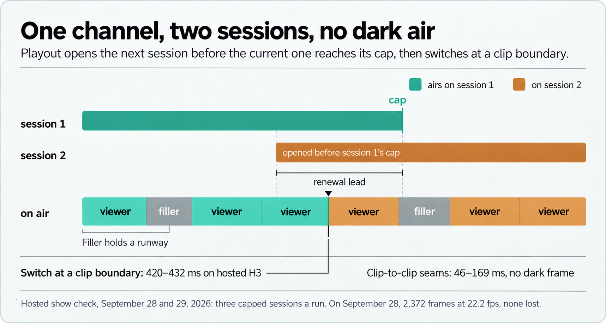

<div align="center">


# reactor-effect

**Live audio and video production with [Effect](https://effect.website).**<br />
Stream speech, generate video, and keep a programme on air.<br />
Choose generation providers through Effect; Reactor supplies the existing video and audio sessions.

[](https://www.npmjs.com/package/reactor-effect-client)
[](https://github.com/mannyc2/reactor-effect-client/actions/workflows/ci.yml)
[](https://mannyc2.github.io/reactor-effect-client/)
[](./LICENSE)

[Documentation](https://mannyc2.github.io/reactor-effect-client/) ·
[Quickstart](https://mannyc2.github.io/reactor-effect-client/start/quickstart/) ·
[Examples](#examples) ·
[Hosted evidence](https://mannyc2.github.io/reactor-effect-client/reference/hosted-evidence/) ·
[For coding agents](https://mannyc2.github.io/reactor-effect-client/reference/agents/)

</div>

<br />

<a href="https://github.com/mannyc2/reactor-effect-client/releases/download/media/showreel.mp4"></a>

<sub>Real H3 output, decoded in-process and recorded by the hosted <code>showreel</code> check on October 1, 2026: one <code>Playout</code>, five scenes back to back, seams of 89–120 ms with no dark frame. <a href="https://github.com/mannyc2/reactor-effect-client/releases/download/media/showreel.mp4">The whole reel, with sound</a>.</sub>

<br />



## Generation and production

This experiment broadens the project beyond a single generation provider. Applications choose
capabilities and compose their providers with Effect Layers:

| Capability                | Implementation                                              | Output                                            |
| ------------------------- | ----------------------------------------------------------- | ------------------------------------------------- |
| Streaming text to speech  | `SpeechModel` with `CartesiaSpeech` or `OpenRouterSpeech`   | PCM audio blocks as they arrive                   |
| Browser speech playback   | `AudioPlayback` with `BrowserAudio`                         | Audible PCM, output level, and an audio track     |
| Persistent characters     | `Character` with `BrowserCharacter` and your renderer       | Audio-driven animation and a captured video track |
| Generated video and audio | Reactor's `H3`, `FastH3`, and `ViduS2Avatar`                | Session media and model-specific controls         |
| Scheduled production      | `Playout` with `H3Source`, `FastH3Source`, or `LocalSource` | Ordered clips, media streams, and as-run evidence |

The speech adapters use Effect 4.0's native `effect/ai/Model`: an ordinary Layer with provider
and model identity. The application consumes `SpeechModel`, so it can supply another speech
implementation without changing its audio consumer. No Reactor session or native addon is needed
for HTTP speech generation.

Generation and presentation have different lifetimes. Streaming speech can emit audio before its
length is known. `BrowserAudio` plays that stream immediately; `BrowserCharacter` drives an
application's renderer from the audio actually playing. Their browser tracks can be recorded or
published by the application. `Playout` schedules finite clips with known or estimated lengths;
it does not schedule an unfinished speech stream or a persistent character. Applications own
mixing, editorial priority, and proof that an audience received the output. Placement, admission
and deadline decisions forecast an unbuilt clip from past clips with the same requested length,
or the model's estimate. Those decisions can be wrong when content determines duration, as with speech.

`Playout.make` requires an explicit model and cleanup evidence: `H3Source.model` with
`H3Source.evidence`, `FastH3Source.model` with `FastH3Source.evidence`, or a renderer's model with
`LocalSource.evidence`. Applications own the service tag over `Playout.Service<Req, Report, E>`
and construct it with `Layer.effect`; provider reports and open failures keep their own types.
`LocalSource.open` also requires a model, and closes with `void`.

The [speech example](./packages/client/examples#streaming-speech) saves incoming PCM and reports
time to first audio. The Cartesia adapter follows its documented bytes API; hosted speech quality
and latency have not been qualified. The existing Reactor evidence below remains provider-specific.
The [character page](./packages/browser/examples#character-page) consumes the library's browser
playback and animation APIs, with OpenRouter speech or a local audio file and an optional Live2D
character. Its server, Cubism loader, model assets and UI belong to the example.

## Try it in a minute, no API key

```sh
git clone https://github.com/mannyc2/reactor-effect-client && cd reactor-effect-client
bun install && bun run build
node examples/quickstart/src/main.ts
```

That runs [one program](./examples/quickstart/src/main.ts) that asks H3 for a clip, follows it to
its end and decodes its frames in your process, on `ReactorTest`, Reactor simulated in memory at
the timing paid runs measured. Set `REACTOR_API_KEY` and only the layer changes: the program is
written to run on hosted H3, and its pieces ran in paid checks, though it has not run there itself.

```ts
const firstClip = Effect.gen(function* () {
  const coordinator = yield* CoordinatorClient.CoordinatorClient;
  const reactor = yield* Reactor.Reactor;
  const session = yield* reactor.create({
    model: H3.modelName,
    tokens: coordinator.tokens({ modelName: H3.modelName, maxSessionDuration: "2 minutes" }),
  });
  const h3 = yield* H3.make(session);
  yield* h3.setAutoplay(true);
  const media = yield* session.decoded; // BGRA frames and PCM, in this process
  yield* media.video("main_video").pipe(
    Stream.runForEach((frame) => Console.log(`frame ${frame.width}x${frame.height}`)),
    Effect.forkScoped,
  );

  const submission = yield* h3.prepare({ prompt: "A paper boat on a rainy street", seconds: 5 });
  yield* submission.submit;
  const clip = yield* h3.operation(submission);
  yield* clip.reached("started");
  yield* clip.ended;
}).pipe(Effect.scoped);
```

## Production with Reactor

- **Stay on air.** `Playout` is a keyed schedule of clips in priority lanes, with filler that holds
  a runway, deadlines, cues and edits. It renews sessions before their cap and switches at a clip
  boundary. On hosted H3, seams measured 46–169 ms with no dark frame, and a planned switch between
  sessions 420–432 ms.
- **Frames in Node and Bun, no browser.** `reactor-effect-native` binds Reactor's `reactor-webrtc`
  crate (libwebrtc) through Node-API and hands your process owned BGRA frames and PCM, in process
  or in a child process per connection (the child needs Node), with no browser in between. On
  hosted H3: 1344×768 at about 24 fps, no frame lost.
- **Build and test offline.** `ReactorTest` speaks the real wire protocol in memory, with H3's
  timing measured on paid runs and 23 faults to inject, from a failed build to a lost reply or a
  moderation verdict. On `TestClock`, an hour of programme with six renewals runs in about 20
  seconds, or 3 with simulated media off. CI never pays.
- **Know what reached Reactor.** Every failed command says whether it was never sent, answered, or
  unknown. An enqueue whose reply was lost is never sent again, so a lost reply never plays a clip
  twice.
- **Sessions outlive tokens and processes.** Tokens bound to a session refresh before they expire.
  A dropped connection recovers on the same session: on hosted H3 its picture was back 1.82–1.95 s
  after the drop. A crashed owner's session can be taken over by another process: an attach was
  ready 3.06 s after the kill.
- **Billing safety as an API.** Every creating token must state its session's cap, `close` confirms
  termination with an independent read, and `Session.mayStillBill` says whether a closed session
  may still bill. All 28 paid sessions in the hosted evidence ended with termination confirmed.

The hosted figures come from paid runs between 2026-09-24 and 2026-10-01, on the 0.3.0-rc.0 to
0.9.0 libraries; [below](#measured-on-hosted-reactor) each one names its run.

## Examples

| Example                                                      | What it shows                                                                                                                                                                                        | Without a key            |
| ------------------------------------------------------------ | ---------------------------------------------------------------------------------------------------------------------------------------------------------------------------------------------------- | ------------------------ |
| [Quickstart](./examples/quickstart)                          | One clip from prompt to its end, with its frames decoded, in one file                                                                                                                                | runs on `ReactorTest`    |
| [Terminal viewer](./examples/terminal)                       | H3 drawn in your terminal from decoded frames: no browser anywhere                                                                                                                                   | runs on `ReactorTest`    |
| [Avatar](./examples/avatar)                                  | A Vidu S2-Avatar character made from a photo: one call, its picture decoded in your process, both sides' transcripts                                                                                 |
| [Live channel](./examples/livestream)                        | Your own 24/7 AI channel: viewers prompt it, filler covers the gaps, sessions renew with no dark air, many browsers watch; needs ffmpeg, and can restream over RTMP (tried against a local listener) | runs on `ReactorTest`    |
| [H3 Studio](./packages/browser/examples)                     | A page that runs its own session over WebRTC: H3's queue live, references, each clip's lifecycle                                                                                                     | runs in the browser      |
| [Character page](./packages/browser/examples#character-page) | Streaming speech through library playback, heard alone or with a persistent Live2D character                                                                                                         | plays a local audio file |
| [Capture](./packages/native/examples)                        | A command line that writes a clip's decoded frames and audio to an MP4                                                                                                                               | paid only                |
| [Rundown](./packages/client/examples)                        | An application service over `Playout`, tested offline on the test clock                                                                                                                              | runs on `ReactorTest`    |

The [streaming speech example](./packages/client/examples#streaming-speech) uses a separate TTS provider and needs explicit Cartesia credentials, model and voice.

## Packages

| Package                                        | What it gives you                                                                                                                                                                                          | Runs in                |
| ---------------------------------------------- | ---------------------------------------------------------------------------------------------------------------------------------------------------------------------------------------------------------- | ---------------------- |
| [`reactor-effect-client`](./packages/client)   | `SpeechModel`, `CartesiaSpeech`, `OpenRouterSpeech`, `AudioPlayback` and `Character`; `Reactor`, `Session`, `CoordinatorClient`, `H3`, `FastH3`, `ViduS2Avatar`, `Playout`, its sources, and `ReactorTest` | Node, Bun and browsers |
| [`reactor-effect-browser`](./packages/browser) | `BrowserAudio` for PCM playback, `BrowserCharacter` for animation and canvas capture, `BrowserPeer` for WebRTC, and `BrowserMedia` for session tracks                                                      | Browsers               |
| [`reactor-effect-native`](./packages/native)   | `NativePeer` on a Node-API addon over Reactor's `reactor-webrtc` crate, prebuilt for Linux x64 (glibc) and macOS on Apple silicon                                                                          | Node and Bun           |

```sh
npm install --save-exact reactor-effect-client effect@4.0.0
npm install --save-exact reactor-effect-native @effect/platform-node@4.0.0   # Node and Bun
npm install --save-exact reactor-effect-browser                              # browsers
```

Every package peers on Effect `~4.0.0`, any 4.0.x patch but not 4.1: the Effect modules the SDK
builds on, such as `effect/http` and `effect/rpc`, are marked unstable, and Effect may change those
in a minor release. Keep `effect` and every `@effect/*` package at one version. With
`@effect/platform-node`, also pin `@effect/platform-node-shared` to that version with an override.
[Installation](https://mannyc2.github.io/reactor-effect-client/start/installation/) covers the
details, and the [documentation](https://mannyc2.github.io/reactor-effect-client/) covers sessions,
H3, the playout, media, errors, testing and cost control.

## Measured on hosted Reactor

CI runs every check against `ReactorTest`. Hosted Reactor is exercised by paid checks the
maintainer runs with a budget, and each run keeps its evidence in
[`integration/hosted/evidence`](./integration/hosted/evidence). The runs below date from 2026-09-24
to 2026-10-01, on the 0.3.0-rc.0 to 0.9.0 libraries, with the native host in process under Bun or
isolated under Node. On 0.9.0 only the `showreel` check has run, from a checkout with the published
addon; 0.9.0's other checks, its published client packages, the browser package and the in-process
native host under Node have not run on hosted Reactor yet.

| What                                                | Measured                                                                               | Runs                             |
| --------------------------------------------------- | -------------------------------------------------------------------------------------- | -------------------------------- |
| Video through the native host                       | 1344×768 at 23.7–24.2 fps, all 124 frames of each clip                                 | 0.3.0 to 0.8.0, 09-24 to 09-28   |
| Five scenes on one session, recorded in-process     | 958 frames at 1344×768 and 24 fps; seams 89–120 ms, no dark frame; about $1.68         | `showreel` on 0.9.0, 10-01       |
| Seams between clips on one session                  | 46–169 ms, no dark frame                                                               | 0.8.0, 09-28 and 09-29           |
| A planned switch to a renewed session               | 420–432 ms                                                                             | two `show` runs, 09-28 and 09-29 |
| A dropped connection, recovered on the same session | ready 1.64–1.84 s later, picture back at 1.82–1.95 s, nothing re-allocated             | two `show` runs, 09-28 and 09-29 |
| A killed owner's session, taken over                | another process attached 3.06 s after the kill; `H3Source.resume` adopted it in 2.71 s | `adoption`, 09-28                |
| A session ended by moderation under the playout     | its Ready clip rebuilt on a replacement opened 3.17 s later; 5.3 s with no clip on air | `show`, 09-28                    |

The [hosted evidence page](https://mannyc2.github.io/reactor-effect-client/reference/hosted-evidence/)
lists every run with its date, commit and spend, and what has not run on hosted Reactor yet.

## Status

reactor-effect is an independent project, not an official Reactor SDK. H3 Reference Turbo Realtime,
FastH3 and Vidu S2-Avatar have providers; H3 and FastH3 have playout sources. [FastH3Source](https://mannyc2.github.io/reactor-effect-client/guides/fasth3/) has offline tests but no hosted qualification yet.
[Limits and support](https://mannyc2.github.io/reactor-effect-client/reference/limits/) says which
platforms it runs on and what has not been exercised on hosted Reactor yet. It is at 0.x, so a minor release can still change the API; the
[changelog](./CHANGELOG.md) says what changed and how to upgrade. Every release is published to npm
with provenance by the [release workflow](./.github/workflows/release.yml). Protocol material and
native WebRTC dependencies are attributed in [NOTICE](./NOTICE).

## Contributing

```sh
bun install --frozen-lockfile
bun run verify --profile portable
```

[CONTRIBUTING.md](./CONTRIBUTING.md) is how the repository works and how its code reads;
[scripts/README.md](./scripts/README.md) lists the verification profiles CI runs;
[SECURITY.md](./SECURITY.md) is for vulnerability reports. Licensed under [Apache-2.0](./LICENSE).
